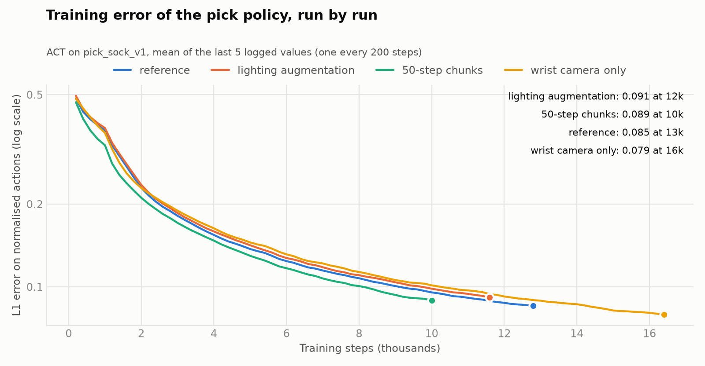

# Journal des explorations

Ce qu'on a essayé, ce qu'on a mesuré, ce qu'on en a conclu. Une entrée par question, avec les
chiffres : c'est la matière des slides. Chaque chiffre renvoie à sa source. À compléter au
fil des essais ; les chiffres encore absents sont listés à la fin.

Mettre à jour les courbes et le tableau des essais : `uv run python scripts/hpc/run_logs.py`.
Vérifier un modèle sans robot : `uv run python scripts/replay_check.py --policy <dossier>`.

## 1. Trouver les objets au sol sans annoter une seule image

| Approche | Résultat |
|---|---|
| Détecteur à vocabulaire ouvert (YOLOE) | 3 objets trouvés sur 7 |
| Détection par la couleur du sol | 7 sur 7 en plein jour, mais 18 images sur 122 le soir |
| **Notre détecteur appris** (YOLO11n, annoté automatiquement, images rééclairées) | **117 images sur 122**, 23 sur 24 sur des images du soir jamais vues, aucune fausse alerte, 10 ms par image |

Conclusion : un petit détecteur entraîné sur nos propres images, sans annotation manuelle,
bat les deux approches « sans entraînement ».

**Puis sur la caméra du robot.** Ce détecteur, appris sur des photos de téléphone, ne
transférait pas. Le robot s'est annoté tout seul : dans chaque épisode de saisie, l'objet est
au sol sur la première image et n'y est plus sur la dernière ; la différence des deux donne
la boîte, sans personne pour la dessiner (58 épisodes de canette sur 68 annotés ainsi).

| Images de la caméra du robot, jamais vues | Détecteur v1 (téléphone) | Détecteur v2 (+ caméra du robot) |
|---|---|---|
| Canette | 4 sur 14 | **14 sur 14** |
| Chaussette | 3 sur 12 | **10 sur 12** |
| Sol vide, aucune détection attendue | 14 sur 14 | 14 sur 14 |

Limite : ces images sont prises de près ; le v2 n'a pas été essayé à la distance du balayage
ni sur un autre sol. Source : `docs/workstreams/WS2_perception.md`.

## 2. Où entraîner : le laptop ou le cluster

| Machine | Secondes par pas | 100 000 pas |
|---|---|---|
| Mac M5 | 1,9 | 53 heures |
| Cluster DTU, une carte V100, deux caméras | 0,174 | 4 h 50 |
| Cluster DTU, une carte V100, caméra de poignet seule | 0,099 | 2 h 45 |

Le cluster va onze fois plus vite. Sa file était pleine la nuit de l'entraînement (près de
1 000 jobs en attente) ; nos quatre jobs ont pourtant démarré en 5 à 16 minutes.
Source : journaux des jobs du 15 nov., `docs/TRAINING.md`.

## 3. Le lien radio entre le robot et le laptop

- Les deux caméras pèsent **61 Mbit/s** (640×480, JPEG qualité 90, 30 images par seconde).
- Retard des images : 2 s à 10 m avec des tables sur le trajet, 1 s à 5 m, presque nul de
  près. Une personne sur le trajet suffit à le faire réapparaître.
- Réseau émis par la Pi (lien direct) : 6 ms, contre 38 à 143 ms en passant par un téléphone.

| Qualité JPEG | Poids du flux |
|---|---|
| 90 (réglage de LeRobot) | 61 Mbit/s |
| 75 | 37 Mbit/s |
| 60 | 28 Mbit/s |

Conclusion : laptop à moins de 5 m, lien direct, un seul programme connecté au robot.
Source : `docs/ROBOT_NETWORK.md`.

## 4. Un enregistreur que le pilote comprend

| Problème vu sur le robot | Mesure | Correction |
|---|---|---|
| Messages en rafale, rien ne se sauvegarde | avec un bras simulé en retard de 0,4 s : 0 épisode sauvegardé en 30 s | « de retour au repos » exige d'avoir quitté le repos : 2 épisodes sur 2 |
| Terminal illisible | 101 lignes à l'écran pour deux épisodes | 9 lignes ; l'encodeur vidéo écrit dans un fichier |
| Terminal et Rerun en désaccord | deux textes écrits séparément | un seul statut, affiché aux deux endroits |
| Le pilote ne décide de rien | démarrage et fin automatiques | flèche droite pour armer, départ au premier mouvement, fin au retour au repos |

Leçon : la répétition sans matériel ne reproduisait pas le retard du vrai bras. Le robot
simulé a maintenant ce retard. Source : `docs/CE_SOIR.md`, « Le guide du pilote ».

## 5. Le premier dataset : `pick_sock_v1`

| Mesure | Valeur |
|---|---|
| Épisodes | 60, en deux sessions de 30 (12,7 minutes, 30 images par seconde) |
| Durée d'un épisode | de 7,8 à 18,2 s, médiane 12,6 s |
| Saisies réussies | **59 sur 60** (dernière image du poignet regardée pour chaque épisode) |
| Pose de départ et de fin | jamais à plus de 8° de `home` |
| Images répétées pendant que le bras bouge | 13 %, jamais deux de suite |
| Pince en fin d'épisode | 2,3 à vide, 5,7 en médiane sur la chaussette |

L'épisode raté a été retiré avant l'entraînement (59 épisodes, 22 408 images). Vu aussi : la
chaussette tenue pend devant la caméra avant en fin d'épisode.

**Que voient les caméras au départ ?** Première image de chacun des 59 épisodes :

| À la première image | Épisodes |
|---|---|
| Chaussette visible par les deux caméras | 47 |
| Par la caméra avant seulement | 10 |
| Par la caméra de poignet seulement | 2 |
| Par aucune | 0 |
| Chaussette entière dans l'image | 9 pour la caméra avant, 11 pour le poignet |

La chaussette est donc toujours vue par au moins une caméra, mais presque toujours coupée
par un bord de l'image : la zone de saisie est au bord du champ des deux caméras. La caméra
de poignet la voit en moins d'une seconde dans 95 % des épisodes, en 1,9 s au plus tard.
Conséquence : au départ, le modèle « caméra de poignet seule » ne voit rien une fois sur six,
et un plan de 100 actions l'engage pour 3,3 s. Raccourcir le plan à l'essai
(`--n-action-steps 30`) le fait regarder de nouveau chaque seconde, sans réentraîner.

Images : `figures/sock_v1_first_images_front.jpg`, `figures/sock_v1_first_images_wrist.jpg`
(première image de chaque épisode), `figures/sock_v1_last_images_wrist.jpg` (dernière image
des 60 épisodes d'origine : l'épisode 31 est le seul où la pince est vide).
Source : `docs/REGISTRY.md`.

**Le second dataset, `pick_can_v1`** : 68 épisodes de canette écrasée (12,3 minutes, de 8,1 à
14,6 s), tous réussis après retrait de deux saisies ratées par le pilote. Poses de départ et
de fin à moins de 13° de `home`, base immobile. Image : `figures/can_v1_last_images_wrist.jpg`
(dernière image du poignet des 68 épisodes).

## 6. Quatre entraînements au lieu d'un

Même modèle (ACT), même dataset, une seule différence par essai, pour ne pas tout miser sur
un réglage.

| Essai | Ce qui change | Pourquoi |
|---|---|---|
| `act_sock_v1` | rien : deux caméras, plans de 100 actions, 100 000 pas | la référence |
| `act_sock_v1_aug` | luminosité, contraste, saturation et teinte tirés au hasard | la démo a lieu dans une autre salle, sans notre éclairage |
| `act_sock_v1_c50` | plans de 50 actions | regarder les caméras deux fois plus souvent |
| `act_sock_v1_wrist` | caméra de poignet seule | ne pas dépendre du décor vu par la caméra avant |

Les quatre apprennent au même rythme : l'erreur est divisée par cinq en 10 000 pas, par dix en
40 000. Les chiffres de la figure sont dans `docs/figures/training_curves.csv`.

La canette a ses deux essais (référence et éclairage aléatoire), lancés à 5 h 55 :
`figures/training_curves_can.png`.

**Une piste écartée : un seul modèle pour les deux objets.** L'outil de LeRobot fusionne les
deux datasets en 5 secondes (127 épisodes), mais le résultat ne se charge pas : ses vidéos ne
correspondent plus à ses épisodes (image demandée à 396 s, image trouvée à 1 879 s). Repéré en
chargeant des images avant tout envoi ; le dataset fusionné n'a pas été entraîné. Tant qu'il
n'y a pas de modèle commun, la mission doit choisir le modèle selon l'objet détecté.

## 7. Le modèle fait-il ce que faisait le pilote ?

On rejoue des épisodes enregistrés dans le modèle, avec le code même que le robot exécute,
et on compare ses commandes à celles du pilote (`scripts/replay_check.py`). Mesures à
5 000 pas, sur trois épisodes :

| Essai | Écart moyen aux commandes du pilote | Un bras qui resterait immobile |
|---|---|---|
| Référence | **5,3°** | 35,5° |
| Horizon de 50 | 5,5° | 35,9° |
| Caméra de poignet seule | 6,0° | 35,1° |
| Éclairage aléatoire | 6,2° | 38,9° |

En fin d'entraînement, mêmes épisodes, modèles finaux (dim. 15, 11 h 30) :

| Modèle final | Écart moyen au pilote | Un bras qui resterait immobile |
|---|---|---|
| Chaussette, référence (100 000 pas) | **1,5°** | 35,7° |
| Chaussette, horizon de 50 (40 000 pas) | 2,0° | 35,9° |
| Chaussette, éclairage aléatoire (40 000 pas) | 2,4° | 35,5° |
| Chaussette, caméra de poignet seule (40 000 pas) | 2,4° | 35,1° |
| Canette, référence (100 000 pas) | **1,3°** | 37,6° |
| Canette, éclairage aléatoire (40 000 pas) | 2,5° | 37,8° |
| Le modèle de la chaussette, rejoué sur des canettes | 16,8° | 37,9° |

L'écart est passé de 5,3° à 1,5° entre 5 000 et 100 000 pas. Un modèle ne vaut que pour son
objet : celui de la chaussette, sur des canettes, fait dix fois plus d'écart. Tous tournent à
29 ou 30 commandes par seconde sur le Mac.

Contre-épreuves sur la référence :

| Ce qu'on donne au modèle | Écart | Lecture |
|---|---|---|
| Les vraies images | 5,3° | |
| Des images noires | 33,3° | sans images, il ne bouge presque pas |
| Les images d'un autre épisode | 15,4° | il va là où il voit la chaussette |
| Les deux caméras inversées | 5,3° | aucun effet : ACT ne sait pas quelle caméra est laquelle |

Mêmes contre-épreuves sur le modèle final de la canette (1,3° avec les vraies images) : 32,0°
avec des images noires, 19,4° avec les images d'un autre épisode.

Ce que cela prouve : toute la chaîne d'inférence (caméras, couleurs, ordre des articulations,
normalisation) est celle de l'entraînement, et le modèle se sert des images. Ce que cela ne
prouve pas : la réussite sur le robot. Ces épisodes ont été vus à l'entraînement.

## 8. Notre méthode face aux gagnants de RoboHack 2026

| Point | Eux (insertion d'une cheville, bras fixe) | Nous |
|---|---|---|
| Modèle | ACT, réglages par défaut | ACT, réglages par défaut |
| Démonstrations | 50 pour leur bon modèle, 110 pour l'autre | 59 |
| Caméras | poignet + vue large | poignet + caméra avant du robot |
| Entraînements | 4, sur 4 plateformes | 4, sur un cluster |
| Volume | batch 16 × 60 000 pas | batch 8 × 100 000 pas |
| Réussite sur le robot | 26 % (80 % de prises initiales) | à mesurer |

Leur modèle à 110 démonstrations et batch 128 a fait bien pire, faute d'avoir ajusté le taux
d'apprentissage. Leur code ne contient aucun réglage fin. Leçon : ils ont gagné avec une
réussite d'une fois sur quatre ; une boucle complète et un pitch clair comptent plus.
Sources : github.com/Encrux/robohack26, boesch.dev/posts/robohack.

## 9. Naviguer et cartographier sans capteur de distance

Le robot n'a que deux caméras et ses roues. Il balaie la pièce, quitte sa route
pour un objet, le dépose à la poubelle et revient où il était. Sa carte : l'odométrie, plus
l'empreinte au sol de la caméra avant. Le marqueur de la poubelle est son seul point fixe : à
chaque visite, il y relit sa position et son cap.

Mesures en simulation, avec la machine à états et la navigation réelles, pièce de
2,4 × 1,8 m, 4 objets, 2 stations (`make sim`) :

| Roues simulées | Avec les marqueurs | Marqueurs jamais vus |
|---|---|---|
| Parfaites | 4 déposés sur 4, retour à 2 cm de l'origine, 3 min 19 | — |
| Glissent de 4 %, cap qui dérive de 1,7° par mètre | **4 sur 4**, retour à **3 cm** ; chaque visite corrige 4 à 46 cm | 2 sur 4 puis échec, fin à 50 cm de l'origine |
| Glissent de 8 %, cap qui dérive de 3,4° par mètre | 4 sur 4, retour à 5 cm | pas mesuré |

Ces chiffres sont ceux du parcours en rangées (ci-dessous).

**Deux façons de balayer, comparées dans la même pièce simulée.** La base est holonome : elle
peut glisser de côté. Premier parcours, en couloirs : le robot avance, tourne au bout, revient.
Second, en rangées (le mode aspirateur retenu) : il ne tourne jamais, reste perpendiculaire au
mur de la poubelle et glisse de côté ; la caméra regarde toujours la bande de sol suivante.

| | En couloirs, en tournant | En rangées, sans tourner |
|---|---|---|
| Rotation pendant le balayage (pièce vide) | 700° | **0°** |
| Longueur du parcours | 8,4 m | 7,9 m |
| Mission complète, 4 objets, roues parfaites | 3 min 47 | **3 min 19** |
| Sol vu par le balayage seul | 100 % | 91 % : les deux coins près du mur de départ manquent |
| Avec des roues qui glissent de 4 % | 4 sur 4, retour à 3 cm | 4 sur 4, retour à 3 cm |

Le gain en temps est modeste (12 %). Le gain attendu sur le robot est ailleurs : tourner est
ce qui fausse le plus le cap d'une base à roues omnidirectionnelles. Ce n'est pas mesuré.

Conclusion : sans point fixe, l'odométrie seule ne tient pas une mission ; un marqueur
imprimé sur la poubelle suffit. Limite : aucun obstacle n'est vu, et rien de cela n'a encore
tourné sur le robot. Image : `figures/console_mission.png` (la console pendant une mission
simulée). Source : `docs/NAVIGATION.md`.

## Ce qui reste à mesurer

- Le taux de réussite sur le robot : 10 essais par modèle (`scripts/try_pick.py`).
- Le seuil de la pince qui sépare une saisie réussie d'une saisie vide.
- L'effet de la salle de démo : référence contre caméra de poignet seule, dans cette salle.
- Le détecteur réentraîné sur les images de la caméra du robot.
- La boucle complète : trouver, approcher, saisir, déposer, avec les temps.
